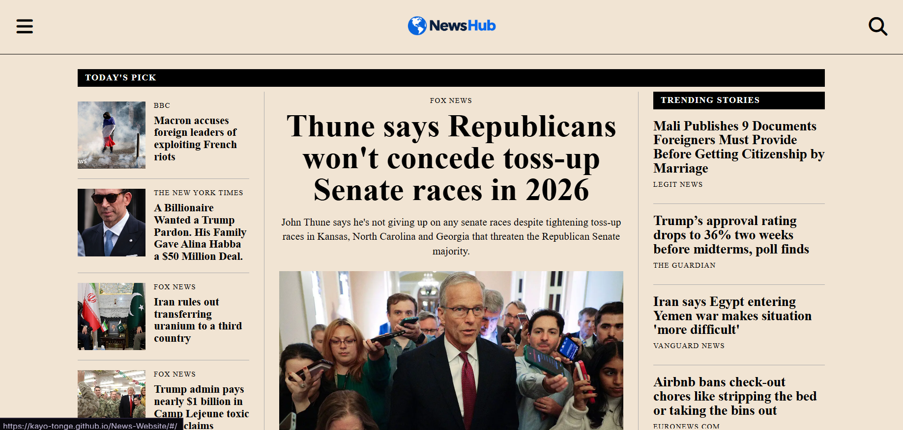

# NewsHub

A responsive news website built with React. Browse top headlines by category or search for any topic in a full-screen search overlay. No account or login is needed.

**Live demo:** [kayo-tonge.github.io/News-Website](https://kayo-tonge.github.io/News-Website/)



## Features

- **Front page** with a featured story, supporting stories, a "Trending Stories" column, and a section for each category
- **Category pages** for General, World, Nation, Business, Technology, Entertainment, Sports, Science, and Health
- **Search overlay** that shows the latest headlines when opened and live results as you type
- **Load More** buttons to fetch additional articles in categories and in search
- **Slide-out sidebar menu** for switching categories
- **Duplicate filtering** so the same story never appears twice on a page
- **Responsive layouts** designed mobile first (375px), with tablet (768px) and desktop (1024px+) layouts
- **Request throttling and caching** so the app stays within the free API limits

## Tech Stack

- [React](https://react.dev/) with [Vite](https://vitejs.dev/)
- [React Router](https://reactrouter.com/) (`HashRouter`, so page refreshes work on GitHub Pages)
- [GNews API](https://gnews.io/) for news data
- [Cloudflare Workers](https://workers.cloudflare.com/) as a small proxy that keeps the API key private
- [GitHub Actions](https://github.com/features/actions) and GitHub Pages for deployment
- [Font Awesome](https://fontawesome.com/) for icons
- Plain CSS (Flexbox, Grid, `clamp()`, media queries)

## Architecture

```
Browser (GitHub Pages)  ──►  Cloudflare Worker (adds API key + CORS)  ──►  GNews API
```

The GNews free plan only allows browser requests from `localhost`, and anything prefixed `VITE_` is readable in the built JavaScript. So the site never talks to GNews directly. It calls a Worker, which adds the secret API key on the server side and returns the response with the right CORS headers.

## Getting Started

### Prerequisites

- [Node.js](https://nodejs.org/) 18 or newer
- A free API key from [gnews.io](https://gnews.io/)
- A free [Cloudflare](https://cloudflare.com/) account

### 1. Deploy the proxy Worker

1. In Cloudflare, create a Worker (**Start with Hello World!**) and name it, for example, `newshub-proxy`.
2. Replace its code with the following, using your own GitHub Pages origin:

```js
const ALLOWED_ORIGINS = [
  "https://YOUR-GITHUB-USERNAME.github.io",
  "http://localhost:5173",
];

export default {
  async fetch(request, env) {
    const origin = request.headers.get("Origin");
    const cors = {
      "Access-Control-Allow-Origin": ALLOWED_ORIGINS.includes(origin) ? origin : ALLOWED_ORIGINS[0],
      "Access-Control-Allow-Methods": "GET, OPTIONS",
      "Vary": "Origin",
    };

    if (request.method === "OPTIONS") {
      return new Response(null, { headers: cors });
    }

    const url = new URL(request.url);
    if (url.pathname !== "/top-headlines" && url.pathname !== "/search") {
      return new Response("Not found", { status: 404, headers: cors });
    }

    const target = new URL("https://gnews.io/api/v4" + url.pathname);
    url.searchParams.forEach((value, key) => {
      if (key !== "apikey") target.searchParams.set(key, value);
    });
    target.searchParams.set("apikey", env.GNEWS_KEY);

    const res = await fetch(target, {
      cf: {
        cacheEverything: true,
        cacheTtlByStatus: { "200-299": 3600, "400-599": 0 },
      },
    });

    return new Response(res.body, {
      status: res.status,
      headers: { ...cors, "Content-Type": "application/json" },
    });
  },
};
```

3. In the Worker's **Settings → Variables and Secrets**, add a **Secret** named `GNEWS_KEY` with your GNews API key.

### 2. Run the app locally

```bash
# Clone the repository
git clone https://github.com/Kayo-Tonge/News-Website.git
cd News-Website

# Install dependencies
npm install

# Point the app at your Worker (no trailing slash)
echo "VITE_API_BASE=https://your-worker-name.your-name.workers.dev" > .env

# Start the dev server
npm run dev
```

Then open the local URL that Vite prints (usually `http://localhost:5173`).

> **Note:** Never commit your `.env` file. It is listed in `.gitignore`. Your real GNews key lives only in Cloudflare.

### 3. Deploy to GitHub Pages

1. In `vite.config.js`, set `base` to your repository name, for example `base: "/News-Website/"`.
2. In your repository, go to **Settings → Pages** and set the source to **GitHub Actions**.
3. Go to **Settings → Secrets and variables → Actions** and add a secret named `VITE_API_BASE` with your Worker URL.
4. Push to `main`. The workflow in `.github/workflows/deploy.yml` builds the app and deploys it.

## How It Works

### Data fetching

All API calls live in `src/services/Api/news.js`:

- `getNews(category, page)` fetches top headlines for a category
- `getSearchResults(query, page)` searches articles by keyword (the query is URL-encoded)
- `getNewsCached` and `getSearchCached` wrap both with throttling and caching

### Rate-limit protection

The GNews free plan allows 100 requests per day and rejects bursts of requests. The app protects itself in three ways:

- **Caching:** responses are saved in `localStorage` for 3 hours (free-plan data is delayed by about 12 hours anyway), so reloads and code edits cost no requests.
- **Throttling:** real network requests run one at a time, about 1.2 seconds apart.
- **Back-off:** after a `429` response, the app stops sending requests for one minute instead of retrying.

Failed requests are never cached. The Worker also caches successful responses for an hour, which is shared by all visitors. To force fresh data while developing, run `localStorage.clear()` in the browser console.

### Search overlay

- Rendered through a React portal so it always covers the whole screen
- Typing is debounced (1 second), so one search sends one request instead of one per keystroke
- Stale responses are ignored if the query changes before they arrive
- With an empty search box, it shows the latest headlines

### Duplicate filtering

`useDuplicateChecker` tracks article IDs and URLs during a render and skips any article it has already seen. A story shown at the top of the home page won't repeat further down.

### Loading categories on the home page

The home page loads one category at a time instead of all at once, which spreads requests out and avoids rate-limit errors.

## Project Structure

```
src/
├── App.jsx                   # Routes and shared state (search, sidebar)
├── main.jsx                  # App entry point
├── index.css                 # All styles
├── components/
│   ├── CategorySection.jsx   # Category block on the home page
│   ├── CloseButton.jsx
│   ├── Footer.jsx
│   ├── Header.jsx
│   ├── LoadMoreButton.jsx
│   ├── SearchOverlay.jsx
│   └── Sidebar.jsx
├── hooks/
│   ├── useDuplicateChecker.jsx
│   ├── useNews.jsx           # Fetches and stores articles for a category
│   └── usePagination.jsx     # "Load more" logic
├── pages/
│   ├── Category.jsx          # Single category page
│   └── HomePage.jsx          # Front page layout
└── services/
    └── Api/
        └── news.js           # API calls, throttling, back-off, and caching
public/
└── logo.png
.github/workflows/
└── deploy.yml                # Builds and deploys to GitHub Pages
```

## Responsive Design

| Width | Layout |
| --- | --- |
| Under 768px | Single column. Featured story, two side-by-side stories, then a list with small images |
| 768px and up | Two-column story rows, five-column trending list, three-column category grid |
| 1024px and up | Three-column front page (list, featured story, trending) and a separate editorial layout for category pages |

## Known Limitations

- The free GNews plan limits requests (100 per day) and returns about 10 articles per request, so articles may occasionally be unavailable when the daily limit is reached
- Some articles have no image or description, so the layout skips or adapts for them
- Search results come from GNews only, with no filtering by date or source
- News data is cached, so very recent stories may take a while to appear

## Possible Future Improvements

- Dark mode
- Filtering search results by date or source
- Saving favorite articles

## Credits

- News data provided by [GNews](https://gnews.io/)
- Icons by [Font Awesome](https://fontawesome.com/)
- Front page layout inspired by [WIRED](https://www.wired.com/)
